<div align="center">




<a href="https://github.com/Yeshwanth-io"></a>
<a href="https://www.linkedin.com/in/yeshwanth-e-958087383/"></a>
<a href="mailto:yeshwanthe2006@gmail.com"></a>


</div>

---

<div align="center">

</div>

```python
class YeshwanthE:
    name = "Yeshwanth E"
    github = "Yeshwanth-io"
    university = "Anna University — College of Engineering Guindy"
    degree = "B.E. Geo-Informatics Engineering"
    diploma = "Electronics and Communication Engineering"
    interests = [
        "AI and Computer Vision", "Embedded Systems", "IoT and Robotics",
        "Geospatial Intelligence", "Software Development", "Remote Sensing"
    ]

    def mission(self):
        return "Build intelligent solutions for real-world problems"
```

I'm an engineering student interested in connecting **electronics, software, AI, computer vision, and geospatial technologies** to build practical solutions. I enjoy interdisciplinary projects that combine hardware, data, and software.

- 🔭 Exploring intelligent engineering and monitoring systems.
- 🤖 Interested in embedded systems, robotics, and sensor integration.
- 🌍 Exploring GIS, remote sensing, and satellite-data applications.
- 💻 Building software tools, websites, and automation workflows.
- 🤝 Open to engineering collaborations, research, and open-source projects.

<div align="center">

</div>

---

<div align="center">


**Programming & Web**


**Tools & Data**


**Engineering & Geospatial**


</div>

<details>
<summary><b>View technical focus areas</b></summary>

| Area | Focus |
|---|---|
| Programming | Python, C/C++, Java, JavaScript |
| Web | HTML, CSS, Node.js, APIs |
| Embedded & IoT | ESP32, sensors, connected devices |
| Computer vision | OpenCV, image processing, detection workflows |
| Geospatial | QGIS, ArcGIS, remote sensing, terrain analysis |
| Tools | Git, GitHub, VS Code, databases |

</details>

---

<div align="center">


</div>

<details>
<summary>⛏️ <b>RAKSHA — AI-Based Rockfall Prediction</b></summary>

A hardware–software integrated framework exploring rockfall prediction and hazard monitoring in open-pit mines.

- Explores InSAR and sensor-based slope monitoring.
- Focuses on slope instability and hazard assessment.
- Reported as presented at GeodCon 2026, New Delhi, at INSA.

`Remote Sensing` `InSAR` `Sensors` `Geospatial Analysis`
</details>

<details>
<summary>👁️ <b>Computer Vision-Based Defect Detection</b></summary>

A workflow designed to identify defects in material-testing processes and automate technical report generation.

- Applies image processing to inspection tasks.
- Connects detection workflows with report automation.

`OpenCV` `Image Processing` `Automation`
</details>

<details>
<summary>🌾 <b>IoT-Based Agriculture Monitoring</b></summary>

A sensor-based monitoring concept for soil and environmental conditions to support smart agriculture.

`ESP32` `Sensors` `IoT` `Smart Agriculture`
</details>

<details>
<summary>🏠 <b>ESP32 Smart Home Automation</b></summary>

A connected-home prototype focused on sensor integration, remote appliance control, and automation.

`ESP32` `Embedded Systems` `IoT`
</details>

<details>
<summary>🌊 <b>Rural Drainage Network Mapping</b></summary>

A geospatial workflow for studying rural drainage networks using point-cloud data and Digital Terrain Models.

- Explores drainage challenges in rural areas.
- Reported as submitted at Geointel'26 as part of a five-member team.

`GIS` `Point Clouds` `DTM` `Drainage Analysis`
</details>

<details>
<summary>🤖 <b>Autonomous RC Car & Self-Balancing Robot</b></summary>

Robotics prototypes exploring sensors, embedded programming, and control systems.

`Robotics` `Sensors` `Control Systems`
</details>

<details>
<summary>📦 <b>QR Code-Based Tracking System</b></summary>

A web-based tracking concept for identification and data management using QR codes.

`Web Development` `QR Codes` `Data Management`
</details>

<details>
<summary>⚙️ <b>NH Repogen Pro</b></summary>

A software tool for automating technical and laboratory report generation.

`Software Engineering` `Workflow Automation`
</details>

<details>
<summary>🌐 <b>AI-Integrated Websites & E-Commerce</b></summary>

Web development projects spanning company websites, portfolio sites, and e-commerce applications.

`HTML` `CSS` `JavaScript` `APIs` `Databases`
</details>

<div align="center">

</div>

---

<div align="center">

</div>

| Role | Organization |
|---|---|
| Full-Stack Developer | NH Instruments |
| Part-Time Software Engineer | NH Instruments LLP |
| Freelance Software Developer | Analytical Research & Metallurgical Laboratories Pvt. Ltd. |
| Project Team Lead Intern | Indian Institute of Technology Bombay |

<details>
<summary><b>🎓 Education details</b></summary>

**B.E. Geo-Informatics Engineering** — College of Engineering Guindy, Anna University  
2025–Present · CV-reported CGPA: 6.5/10

**Diploma in Electronics and Communication Engineering** — Guru Raagavendra Polytechnic College  
2022–2024 · CV-reported percentage: 94.87%

</details>

---

<div align="center">


<a href="https://www.ieee.org/"></a>
<a href="https://www.ieee.org/"></a>
<a href="https://www.ieee.org/"></a>
</div>

Technical interests:
- **IEEE GRSS:** Geoscience, remote sensing, and satellite applications.
- **IEEE APS:** Antennas, propagation, and communication technologies.
- **IEEE AESS:** Aerospace and electronic systems.

> Keep the IEEE society badges only if these reflect your current memberships.

---

<div align="center">


<br/><br/>


<br/><br/>


---

<div align="center">


<a href="https://github.com/Yeshwanth-io"></a>
<a href="https://www.linkedin.com/in/yeshwanth-e-958087383/"></a>
<a href="mailto:yeshwanthe2006@gmail.com"></a>

<br/><br/>


*Think beyond boundaries. Engineer beyond limitations.*


</div>
